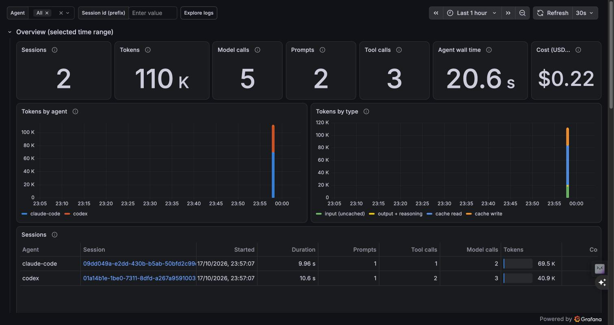

# AI Agent Observability

One local dashboard for every AI coding agent you run: **Claude Code, Codex CLI,
Grok Build, Gemini CLI and Qwen Code**. See every session, how long it took, how
many tokens it burned, what it cost, and — live — every prompt, shell command,
tool call and model call the agent makes in the background.

Built on OpenTelemetry (all five CLIs export it natively) and the
[`grafana/otel-lgtm`](https://github.com/grafana/docker-otel-lgtm) all-in-one image
(OTel Collector + Prometheus + Loki + Tempo + Grafana). Everything runs locally
in one container; no data leaves your machine.



## What you get

| Panel | Shows |
|---|---|
| **Overview** | Sessions, tokens, model calls, prompts, tool calls, agent wall time, cost |
| **Tokens by agent / by type** | Token burn over time; input vs output vs cache read/write, normalized across vendors |
| **Sessions** | One row per session: agent, start, duration, prompts, tool calls, model calls, tokens, cost. Click a session to filter the whole dashboard to it |
| **Live activity** | A tail of what every agent is doing: `» prompt`, `$ shell command [approved]`, `model · tokens · latency · $`, `« response` |
| **Shell commands executed** | Every command any agent ran, with success and duration |
| **Tool usage, latency, tool calls over time** | Which tools each agent leans on and how fast model calls are |
| **Recent traces** | Span waterfalls (interaction → model call → tool) for agents that emit traces |

## Quick start

Requirements: Docker (Docker Desktop, OrbStack, Colima…) and Python 3.11+.

```bash
git clone https://github.com/RathinavelRajakannu/ai-agent-observability.git
cd ai-agent-observability
docker compose up -d                       # Grafana on http://localhost:3300
python3 scripts/configure_agents.py        # point installed agents at the collector
```

Restart any running agent sessions, use them as usual, and open
**http://localhost:3300**. The dashboard is the Grafana home page.

`configure_agents.py` only touches agents that are installed, is safe to re-run,
and backs up every file it changes to `~/.ai-observability-backups/`. Use
`--dry-run` to preview it, or `--no-content` to export metrics and events
**without** prompt text, commands or tool arguments.

## How it works

```
Claude Code ─┐
Codex CLI   ─┤  OTLP            ┌─ transform/agent      → agent_name on every signal
Grok Build  ─┼──────────────▶  OTel Collector ─┼─ transform/normalize  → ai_* fields (tokens, session, command, prompt)
Gemini CLI  ─┤  :4317 / :4318   └─ deltatocumulative    → Prometheus-compatible counters
Qwen Code   ─┘                         │
                            ┌──────────┼──────────┐
                         Prometheus   Loki      Tempo   ──▶  Grafana :3300
                         (metrics)   (events)  (traces)
```

Each CLI has its own telemetry schema: different event names, token fields and
session keys. The collector (`otel/otelcol-config.yaml`) maps them all onto one
set of attributes, so the dashboard queries are agent-neutral:

| Normalized field | Claude Code | Codex | Grok Build | Gemini / Qwen |
|---|---|---|---|---|
| `ai_session_id` | `session.id` | `conversation.id` | `session.id` | `session.id` |
| `ai_tokens_input` (uncached) | `input_tokens` | `input_token_count − cached` | `input_tokens` | `input_token_count − cached` |
| `ai_tokens_output` | `output_tokens` | `output_token_count` | `output + reasoning` | `output + thoughts` |
| `ai_tokens_cache_read/write` | `cache_read/creation_tokens` | `cached_token_count` | `cache_read_tokens` | `cached_content_token_count` |
| `ai_command` | `tool_parameters.full_command` | `arguments.cmd` | never exported by Grok | `function_args.command` |
| `ai_cost_usd` | `cost_usd` | — | — | — |

Token totals come from per-request log events rather than counters, so they
include every model call. Codex's startup prewarm request, for example, is missing from
its own token metric.

### Per-agent settings applied

| Agent | Where | What |
|---|---|---|
| Claude Code | `~/.claude/settings.json` → `env` | `CLAUDE_CODE_ENABLE_TELEMETRY=1`, OTLP logs + metrics + traces (`CLAUDE_CODE_ENHANCED_TELEMETRY_BETA=1`), `OTEL_LOG_TOOL_DETAILS`, `OTEL_LOG_USER_PROMPTS` |
| Codex CLI | `~/.codex/config.toml` → `[otel]` | `otlp-http` exporter for logs, metrics, traces; `log_user_prompt` |
| Grok Build | `~/.grok/config.toml` → `[telemetry]` | `otel_enabled`, OTLP endpoint, `otel_log_user_prompts`, `otel_log_tool_details` |
| Gemini CLI / Qwen Code | `~/.gemini/settings.json`, `~/.qwen/settings.json` → `telemetry` | `target: local`, OTLP gRPC endpoint, `logPrompts` |

## Privacy & security

- Every port binds to `127.0.0.1`. Grafana runs with anonymous admin access, so
  **don't expose it** beyond localhost without enabling auth.
- With the default settings, prompts, shell commands, tool arguments and
  (for Codex) tool output are stored in the local Loki. Run
  `configure_agents.py --no-content` if you don't want that.
- Data is kept in the `lgtm-data` Docker volume. Prometheus retention is set
  to 180 days. `docker compose down -v` deletes everything.

## Operating it

```bash
docker compose ps                    # status
docker compose logs -f               # stack logs
python3 scripts/check_panels.py      # run every dashboard query, report empty/failing panels
python3 scripts/build_dashboard.py   # regenerate grafana/dashboards/ai-agents.json after editing
docker compose down                  # stop (data kept)
```

Ports: Grafana `3300`, OTLP gRPC `4317`, OTLP HTTP `4318`, Prometheus `9091`, Loki `3101`.

## Adding another agent

1. Point its OTLP exporter at `http://localhost:4318` (or `:4317` for gRPC).
2. Add a `service.name` match to `transform/agent` and, if its token or session
   fields differ, a few lines to `transform/normalize` in `otel/otelcol-config.yaml`.
3. Add it to `AGENTS` in `scripts/build_dashboard.py` (fixed color), rebuild, and
   run `docker compose restart`.

## Notes & limitations

- **Gemini CLI** with personal Google OAuth is being retired in favour of
  Antigravity. Use a `GEMINI_API_KEY` to keep using it. Antigravity and the Gemini
  desktop app don't export OpenTelemetry.
- **Grok Build** holds back its first events for up to 30 s while it fetches
  its fleet policy, and it never exports shell command text.
- Only Claude Code reports cost. For other agents, multiply tokens by your
  provider's price sheet.
- Uses Prometheus feature flags `created-timestamp-zero-ingestion` and
  `promql-extended-range-selectors` (`increase(...[$__range] anchored)`) so
  short-lived per-session counters are counted exactly.

## License

MIT
